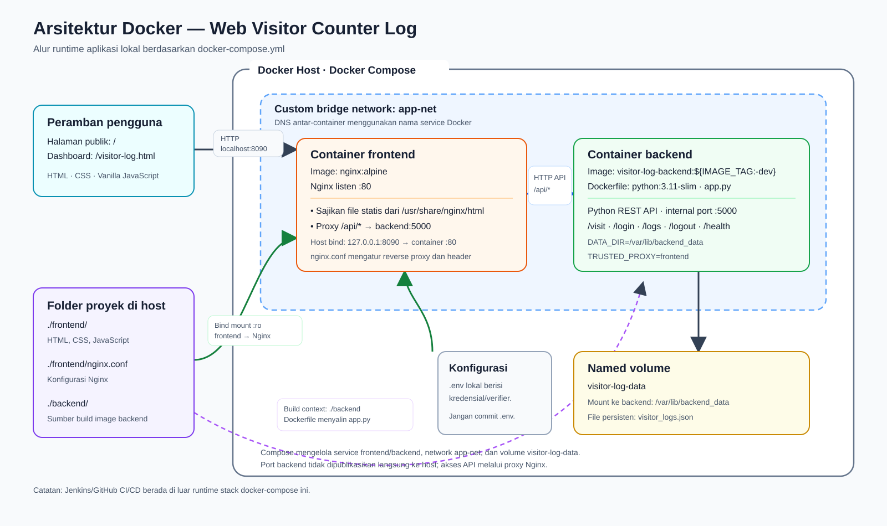

# Web Visitor Counter Log

Aplikasi pencatat kunjungan untuk tugas UTS Cloud Computing, Telkom University. Aplikasi menyediakan halaman publik laboratorium dan dashboard untuk melihat serta mengelola log kunjungan.

## Identitas Kelompok

| Nama | NIM |
|---|---|
| Arga Ulya Abdurohman | 101012301089 |
| Mochammad Hakim Al Irsyad | 101012300152 |
| Sandrina Eka Putri | 101012330279 |

## Studi Kasus

**Kasus 5 — Log & Hit Counter Pengunjung Web (Web Visitor Counter Log).**

Halaman publik mencatat page view saat halaman `/` dibuka. Log berisi halaman, waktu, alamat IP yang terlihat oleh server, dan informasi peramban (user agent). Data ini mencatat page view, bukan identitas atau jumlah pengunjung unik. Dashboard pengelola memerlukan login dan menyediakan grafik, daftar log, tambah log manual, hapus log, dan logout.

## Arsitektur



Diagram dapat dibuat ulang dengan Python tanpa dependensi tambahan:

```powershell
python .\diagram.py
```

- **Frontend:** Nginx menyajikan berkas statis dari folder `frontend/` melalui bind mount. Nginx meneruskan permintaan `/api/` ke service `backend` melalui jaringan Docker.
- **Backend:** REST API Python tanpa framework berat. Port `5000` hanya tersedia di jaringan internal Docker, tidak dipublikasikan langsung ke host.
- **Penyimpanan:** `visitor_logs.json` berada di named volume `visitor-log-data`, sehingga datanya tetap ada saat container backend dihapus dan dibuat ulang.
- **Jaringan:** Kedua service menggunakan custom bridge network `app-net` dan berkomunikasi menggunakan nama service Docker.
- **Alamat lokal:** Frontend tersedia di `http://localhost:8090` secara default dan hanya diikat ke loopback.

## Fitur dan API

API diakses melalui prefix `/api` dari peramban. Endpoint pengelolaan log dan logout memerlukan bearer token hasil login.

| Metode | Endpoint | Keterangan |
|---|---|---|
| `GET` | `/api/health` | Memeriksa kesiapan backend dan penyimpanan. |
| `POST` | `/api/visit` | Mencatat page view publik untuk halaman `/`. |
| `POST` | `/api/login` | Memverifikasi akun pengelola dan mengembalikan token sesi. |
| `GET` | `/api/logs` | Mengambil jumlah dan daftar log; memerlukan autentikasi. |
| `POST` | `/api/logs` | Menambahkan log manual; memerlukan autentikasi. |
| `DELETE` | `/api/logs?index=X` | Menghapus log berdasarkan indeks daftar saat ini; memerlukan autentikasi. |
| `POST` | `/api/logout` | Mencabut token sesi; memerlukan autentikasi. |

Jumlah yang ditampilkan adalah jumlah log yang masih tersimpan. Menghapus log akan mengurangi jumlah tersebut. Indeks penghapusan dapat berubah setelah daftar diperbarui, jadi muat ulang data sebelum memilih log jika ada perubahan oleh pengguna lain.

## Menjalankan Secara Lokal

### Prasyarat

- Docker Desktop atau Docker Engine dengan Docker Compose
- Python 3 untuk menjalankan skrip konfigurasi akun dan pengujian
- Node.js untuk pemeriksaan sintaks JavaScript

### Langkah menjalankan

1. Buka PowerShell di direktori repository.
2. Buat konfigurasi akun pengelola lokal. Skrip akan meminta username dan password secara interaktif; password tidak ditampilkan atau disimpan.

   ```powershell
   python .\setup_account.py
   ```

   Skrip membuat file `.env` yang berisi verifier password, salt, serta port frontend. Jangan commit atau membagikan file ini.

3. Build image backend dan jalankan seluruh stack:

   ```powershell
   docker compose up --build -d
   ```

4. Buka halaman publik di `http://localhost:8090`. Dashboard dapat dibuka melalui `http://localhost:8090/visitor-log.html`; login menggunakan akun yang dibuat pada langkah pertama.
5. Periksa kondisi layanan:

   ```powershell
   docker compose ps
   docker compose exec frontend nginx -t
   ```

   Pemeriksaan API dapat dilakukan dengan membuka `http://localhost:8090/api/health`; respons normal adalah `{"status":"ok"}`.

6. Untuk menghentikan container tanpa menghapus named volume:

   ```powershell
   docker compose down
   ```

   Jangan menambahkan opsi `-v` jika data log perlu dipertahankan. Untuk menghidupkan kembali stack, jalankan `docker compose up -d`.

### Pengujian dan pemeriksaan lokal

Jalankan dari direktori repository:

```powershell
python -m unittest discover -s tests -v
node --check frontend/app.js
node --check frontend/landing.js
node --check frontend/chart.js
node --check frontend/chart-data.js
```

Skrip `tests/docker_smoke.py` juga dapat digunakan untuk smoke test Compose. Skrip itu membuat `.env` uji hanya jika file tersebut belum ada, membangun dan menjalankan stack, lalu **membiarkan resource tetap berjalan**. Skrip menolak berjalan jika `.env` sudah tersedia; jangan menghapus atau menimpa konfigurasi akun yang ada hanya untuk menjalankan tes.

## Konfigurasi Jenkins dan GitHub

Alur yang dituju adalah `git push` ke branch `main` → GitHub Webhook → Jenkins Pipeline → pengujian → build image → deployment → health check. Gunakan Jenkins agent Linux yang dipercaya dan memiliki Docker CLI/Compose serta akses yang memang diperlukan ke Docker Engine. Akses Docker pada praktiknya memberi kewenangan tinggi terhadap host; jangan menjalankan build dari pull request atau kode yang tidak dipercaya.

### Persiapan Jenkins

1. Pasang dan konfigurasi Jenkins, Git, Docker/Compose, serta plugin GitHub dan Pipeline yang diperlukan pada server/agent.
2. Simpan PAT GitHub sebagai Jenkins Credential (jangan menaruh token di repository atau Jenkinsfile). Panduan tugas meminta PAT classic dengan izin `repo` dan `admin:repo_hook`, serta masa berlaku 30 atau 90 hari. Batasi penggunaan credential, catat masa kedaluwarsanya, dan jangan tampilkan nilainya pada log.
3. Buat job Pipeline yang mengambil Jenkinsfile dari branch `main` di repository ini. Hubungkan credential SCM pada konfigurasi job agar `checkout scm` dapat mengakses repository privat.
4. Aktifkan trigger webhook GitHub yang sesuai pada job Jenkins. Atur webhook repository ke URL Jenkins yang dapat dijangkau GitHub melalui HTTPS (umumnya endpoint plugin GitHub Jenkins `/github-webhook/`) dan batasi event ke push. Jika Jenkins berada di jaringan privat, sediakan jalur publik HTTPS yang telah disetujui, misalnya tunnel yang dikonfigurasi untuk tugas, lalu uji dengan push yang aman.
5. Siapkan konfigurasi deployment pada host sesuai kebutuhan pipeline, termasuk file `compose.deploy.yml`, `.env` privat, direktori aplikasi, container Jenkins bernama `visitor-log-jenkins`, dan endpoint health check yang dapat dijangkau agent.
6. Jalankan pipeline dan periksa setiap stage serta health check. Verifikasi pemicu otomatis secara terpisah dengan push ke `main`.

### Catatan penting tentang Jenkinsfile saat ini

Jenkinsfile memiliki lima stage: `Checkout`, `Syntax Check`, `Build Image`, `Automated Deployment`, dan `Health Check`. Implementasi perbaikan ini belum dijalankan di Jenkins/VM. Sebelum menjalankannya pada server, sesuaikan dan validasi konfigurasi lingkungan di dalamnya: pipeline merujuk ke direktori `/home/ubuntu/cloud-computing`, file `deployment/docker-compose.yml` dan `.env` di host, container `visitor-log-jenkins`, serta alamat health check `172.20.100.100:8090`. File deployment tersebut dan konfigurasi server harus disiapkan terpisah; jangan menganggap pipeline siap pakai pada host lain. Jenkinsfile juga belum mendeklarasikan trigger webhook secara mandiri, sehingga trigger harus diaktifkan melalui konfigurasi job/plugin Jenkins.

Build #6 sebelumnya terverifikasi SUCCESS melalui GitHub webhook pada commit dda2cd83a73e14de046898c8863675d7635b1db1. Build #7 gagal dengan error resolusi host. Perbaikan pipeline lokal berikutnya belum di-push atau diuji pada Jenkins; keberhasilan build lama tidak membuktikan pipeline baru berhasil.

Pipeline baru menjalankan syntax check dan unit tests, validasi Compose dengan `config --quiet` (tanpa mencetak secrets), serta `docker compose build backend` dengan tag commit. Deployment men-stage frontend secara rekursif dan Compose dari checkout ke `/home/ubuntu/cloud-computing/deployment`, mempertahankan `.env` privat di direktori induk dan named volume. Hanya file frontend usang di direktori deployment yang dibersihkan. Project Compose tetap `uts-visitor-log`; bind VM tetap `172.20.100.100:8090`. Kedua container aplikasi direcreate, sehingga ada downtime singkat dan sesi login berakhir; visitor logs tetap di named volume.

Health probe memeriksa login HTTP 200, JSON readiness melalui Nginx, dan backend langsung melalui `docker exec`. Budget retry 50 detik; hasil boolean disimpan ke `evidence/health.json` dan diarsipkan Jenkins. HTTPS aplikasi dan masalah DNS VM masih membutuhkan pekerjaan terpisah. Jangan menganggap login HTTP melalui VPN memenuhi persyaratan HTTPS.

Regression checks offline: `python -m unittest discover -s tests -v`. Tidak mengakses data produksi atau Docker daemon.

## Keamanan dan Batasan

- `.env` berisi konfigurasi autentikasi dan wajib dijaga privat. Jangan commit password, token, salt, atau verifier ke GitHub.
- Akun pengelola dibuat melalui `setup_account.py`. Setelah mengganti `.env`, container backend perlu dibuat ulang agar konfigurasi baru digunakan.
- Sesi login berlaku 30 menit. Endpoint login dibatasi hingga 10 percobaan per menit secara global; pencatatan kunjungan publik dibatasi hingga 30 permintaan per menit secara global.
- Endpoint kunjungan publik dan batas permintaan tersebut bukan perlindungan bot lengkap.
- Gunakan HTTPS saat kredensial dikirim melalui jaringan selain loopback. Server demo lokal mengikat port frontend hanya ke loopback.
- Aplikasi ditujukan untuk demonstrasi satu proses backend. Mekanisme lock penyimpanan berlaku dalam proses tersebut; jangan jalankan beberapa backend bersamaan untuk satu file data.
